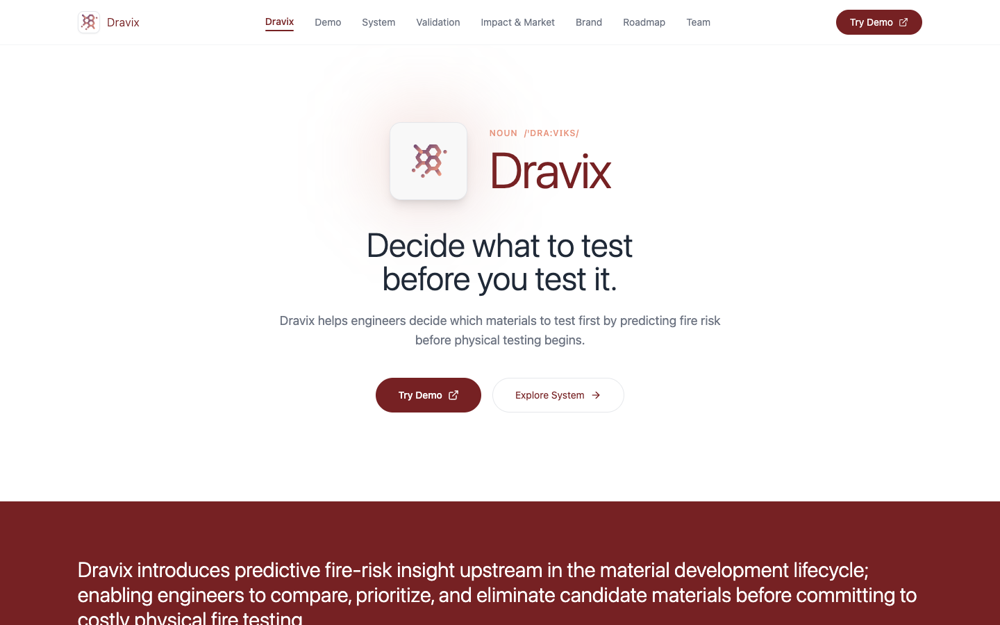
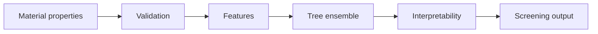

<p align="center">
  
</p>

# Dravix engine

FastAPI service and web demo that return a relative fire-risk screening signal for candidate materials, so teams can choose what to fire-test first.

[](LICENSE)
[](https://doi.org/10.5281/zenodo.23653502)
[](https://doi.org/10.5281/zenodo.23654307)
[](https://dravix-engine.materiamse.com)

Dravix is a screening aid. It does not replace fire testing and is not for certifying a material.

## Where the evidence is

This repository is the serving layer: API, interface and a frozen model. The benchmarked models, the evaluation protocol and the run logs live in [`nikhilesh-s/release-dravix`](https://github.com/nikhilesh-s/release-dravix).

| Item | Link |
|---|---|
| Software record, v2.0.0 | [10.5281/zenodo.23653502](https://doi.org/10.5281/zenodo.23653502) |
| Benchmark dataset, v1, CC BY 4.0 | [10.5281/zenodo.23654307](https://doi.org/10.5281/zenodo.23654307) |
| Benchmark protocol and results | [`BENCHMARK.md`](https://github.com/nikhilesh-s/release-dravix/blob/main/BENCHMARK.md) |
| Live demo, product site | [dravix-engine.materiamse.com](https://dravix-engine.materiamse.com), [dravix.materiamse.com](https://dravix.materiamse.com) ([site repo](https://github.com/nikhilesh-s/dravix-website)) |

## What it does

- Validates structured material descriptors and builds 15 engineered features.
- Scores them with a tree-ensemble (RandomForest-style) model trained on about 1,771 materials.
- Returns a relative screening score, the top 3 feature drivers (`treeinterpreter`) and a variance-based confidence indicator.



## Limitations

- The output is a relative ranking signal. It is not a calibrated prediction of any one fire metric.
- Validation in this repository shows behavioral alignment (for example, higher heat flux gives a higher score). It does not show certification-grade accuracy. See `docs/validation-summary.md`.
- On the benchmark in `release-dravix`, paper-grouped R2 is modest (peak HRR 0.286, total heat released 0.244, average HRR 0.234, time to ignition -0.247). Random splits overstate skill on new materials.
- It does not simulate fire behavior, make regulatory decisions, perform ASTM qualification or retrain itself.
- Any high-consequence decision still needs physical testing and engineering review.

## Quickstart

```bash
git clone https://github.com/nikhilesh-s/dravix-engine.git
cd dravix-engine
python3.11 -m venv .venv && source .venv/bin/activate
pip install -r requirements.txt
uvicorn api.main:app --reload
```

The API runs at `http://127.0.0.1:8000` with docs at `/docs`. The demo interface is a Vite and React app in `frontend/`:

```bash
cd frontend && npm install && npm run dev
```

It calls the hosted API by default. Set `VITE_API_BASE_URL=http://127.0.0.1:8000` in `frontend/.env.local` to use a local backend. To run the endpoint checks:

```bash
DRAVIX_BASE_URL=http://127.0.0.1:8000 python scripts/test_platform_endpoints.py
```

## Layout

| Path | What |
|---|---|
| `api/` | FastAPI entrypoint and HTTP handling |
| `src/` | inference pipeline, feature handling, model loading |
| `data/` | datasets, including the model-ready table |
| `models/` | frozen model artifacts used by the API |
| `frontend/` | demo interface |
| `tests/` | regression and determinism tests |
| `docs/` | architecture, API contract, validation summary, boundaries |

## How to cite

Suravarjjala, N., & Saini, A. (2026). *Dravix: formulation-to-cone-calorimeter property models and benchmark code* (Version 2.0.0) [Computer software]. Zenodo. https://doi.org/10.5281/zenodo.23653502

Machine-readable metadata is in [`CITATION.cff`](CITATION.cff).

## Team

Nikhilesh Suravarjjala (engineering lead), Jaanya Gupta (business lead), Arnav Saini (data engineer).

## Licence

Apache-2.0. See [`LICENSE`](LICENSE).
